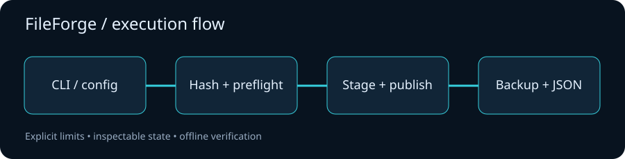

# FileForge

**Know what is in a folder. Change names with a reviewable plan and verified backups.**


FileForge is a standard-library Python CLI for local file automation. It produces
SHA-256 inventories and duplicate groups, applies regex rules to filenames, sorts
files into extension folders and reports large files without reading contents.
Staged batches support swaps while preserving file contents. Every applied batch
has a verified backup and JSON manifest. The default is a dry run.



## Technology

Python 3.11+, `pathlib`, `hashlib`, `argparse` and `tomllib`; no runtime dependency.
Development uses pytest, Ruff, Hatchling, build and pip-audit.

## Installation and quick start

```bash
python -m venv .venv
. .venv/bin/activate
python -m pip install --upgrade pip 'setuptools>=83.0.0'
python -m pip install -e '.[dev]'
python examples/demo.py
fileforge scan examples/fixtures
fileforge duplicates examples/fixtures
fileforge sizes examples/fixtures --min-size 0 --limit 10
fileforge sort examples/fixtures  # review the plan without moving files
fileforge rename examples/fixtures '^draft_' 'final_'
# Explicitly changes names and creates .fileforge-backups/<transaction>/
fileforge rename examples/fixtures '^draft_' 'final_' --apply
```

The demo uses a temporary directory and leaves the checkout fixtures unchanged.
Every command prints machine-readable JSON. `--verbose` adds structured JSON
scan/transaction logs on stderr. Exit status is `0` for success,
`1` for scan errors, and `2` for invalid configuration or an unsafe rename.
Use `--config examples/settings.toml` before the subcommand to configure scans.

## Architecture and features

- Content hashes distinguish equal bytes from merely equal filenames or sizes.
- Symlinks and the internal backup tree are excluded from scans.
- A full preflight rejects duplicate targets, occupied names, path traversal and
  sources whose contents changed after planning.
- Same-directory staging supports swaps; publishing uses exclusive hard links
  so an unexpectedly occupied destination is never overwritten.
- A failed publish restores staged names and retains backups for inspection.

A scan never deletes duplicates. Regex renaming keeps each regular file in its
original directory. Extension sorting moves top-level files into folders inside
the root while preserving existing subtrees; it uses the same backup transaction.
`sizes` reports total bytes and the largest files above a threshold using metadata
rather than content hashes. Hard-link support is required for apply; network or
unusual filesystems can reject the operation.

## Verification and limits

```bash
pytest -q
ruff check .
ruff format --check .
python -m build
pip-audit --progress-spinner off
```

Tests cover duplicate detection, size limits, symlinks, collisions, swaps,
changed content, unsafe paths, rollback, extension sorting, large-file reports
and CLI exit codes. See
[architecture and recovery](docs/architecture.md) and [Python API reference](docs/API.md) for transaction details.
This is a single-process local tool: preflight and rollback are not a distributed
lock, and externally modified directories can require manual recovery from the
saved manifest. Large trees keep inventory metadata in memory.

## Roadmap

- Manifest-driven interactive restore with its own collision preflight.
- Streaming inventory export for very large trees.
- Platform-specific filesystem capability probes.

[Local verification](docs/VERIFICATION.md) · [Contributing](CONTRIBUTING.md) · [Changelog](CHANGELOG.md) · [MIT license](LICENSE)
